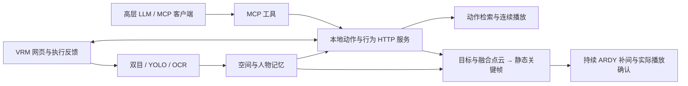

# 栖行 · Roamind

本地 VRM 社交动作与视觉行为研究环境。网页负责角色、房屋、动作播放和双目采集；后端维护视觉记忆、行为状态机、规划及执行反馈；高层 LLM 通过 MCP 下发结构化意图。

支持原生根运动动作检索、连续接缝、空间与人物记忆、找人社交、标注目标接触、OCR 文字触碰，以及坐下、躺卧、拿取和简单电脑交互。自主行为使用视觉记忆；房屋真值接口用于调试。项目仍是研究原型，精细接触与长程自主行为需要继续验证。



ARDY 世界动作管线以静态关键帧为规划结果；目标或地图更新时，从最后确认播放的帧重规划，只替换未来。接口和坐标约定见 [点云世界 ARDY 管线](docs/ARDY_WORLD.md)。

自主探索优先走已确认的通路，并按最近 90 秒的实际视觉定位轨迹为重复路段加代价；没有替代通路时仍可回走。这个偏好不影响手动导航。

## 安装与启动

需要 Node.js 20.19+（或兼容 Vite 7 的更新版本）及 Python 3.11+。以下命令在仓库根目录执行。

```sh
npm ci
python3 -m venv .venv
# Windows 使用 .venv\Scripts\python.exe
.venv/bin/python -m pip install -r server/requirements-core.txt
cp .env.example .env
npm run build
npm run service
```

另开终端运行 `npm run dev`，打开 <http://127.0.0.1:5173/>。网页必须持续打开，才能采集视觉和执行动作。8100 是动作/行为服务，8200 是可选感知服务，8300 是可选 SuperMimic 验证服务；均用于本地研究。

VRM 放入 `models/avatars/`，或在 `.env` 设置 `MOTION_VRM_DIR`；模型列表自动发现 `.vrm` 文件，存在 Wolferia 时优先选择。`MOTION_VRM_FILES` 可限制文件白名单。仓库不分发私人角色、模型权重和 AMASS 派生动作数据。没有配置 VRM 或动作库时，相应能力会提示不可用。

安装流明动作资源：

```sh
npm run setup:lumen
```

此命令下载固定版本的可选资源。源码所需的少量平滑/播放模块已保存在 `vendor/HAST-SEC/`，无需下载资源即可构建。使用流明须遵守其非商业学习与研究许可。动作库准备、感知模型和 ARDY 配置见 [资源安装](docs/ASSETS.md)。

感知服务目前的 ASR 使用 Apple Silicon MLX。其他平台可运行核心与 MCP，但需要替换 ASR 后端后才能使用语音识别。Apple Silicon 上安装感知依赖并下载模型：

```sh
npm run setup:perception
npm run perception:download
npm run perception
```

所有本机路径通过未提交的 `.env` 配置。前端服务地址使用 `VITE_MOTION_LAB_URL`、`VITE_MOTION_PERCEPTION_URL`；修改后重启 Vite，构建产物需重新构建。预览使用 `npm run preview`，资源目录与后端仍需保留，`dist/` 不是自包含部署包。

## LLM 与 MCP

不绑定具体 LLM 厂商。将 [mcp.example.json](mcp.example.json) 复制到客户端配置，将唯一的 `/absolute/path/to/Roamind` 替换为实际仓库路径。启动器会读取项目 `.env`，`MOTION_MCP_PYTHON` 可指定安装了 MCP SDK 的解释器。MCP 使用 stdio，诊断写入 stderr。

推荐调用顺序：

1. `get_agent_context` 获取 `clientId`、视觉坐标、记忆和候选操作。
2. `submit_agent_intent` 提交目标；同一请求重试复用 `request_id`。
3. `get_character_goal` 检查真实状态，直到 `completed/failed/cancelled`。
4. 需要中止时调用 `cancel_character_goal`；自主生活用 `set_agent_autonomy`。

```json
{
  "request_id": "social-001",
  "client_id": "从上下文取得的会话 ID",
  "intent": {"kind": "socialize", "timeout": 300}
}
```

可直接使用支持 Chat Completions 工具调用的 LLM 运行示例：

```sh
# 将 LLM_BASE_URL、LLM_MODEL 和可选 LLM_API_KEY 写入未提交的 .env
.venv/bin/python examples/llm_mcp_client.py --list-tools
.venv/bin/python examples/llm_mcp_client.py --task '找到一个人并打招呼' --client-id YOUR_CLIENT_ID
```

该示例通过真实 MCP SDK 连接工具，支持多轮调用、执行等待和反馈；只暴露高层控制白名单。工具返回的视觉上下文会发送到你配置的 LLM 端点。完整工具分类、坐标和接触约束见 [LLM/MCP 使用说明](docs/LLM_MCP.md)。

## 验证

```sh
npm run build
npm run test:core
npm run test:mcp
# 准备好本地动作库后：
npm run test:table
npm run test:overlap
```

核心测试无需私有 VRM、AMASS、ARDY 权重或感知模型。MCP 合约测试启动真实 HTTP 服务与 stdio MCP 客户端，验证错误处理、意图幂等和执行反馈；它模拟浏览器回报，不代表角色视觉端到端成功。`tests/*_integration.py` 和 `tests/browser-*.js` 需要实际服务、模型及浏览器环境，不能替代基础单测。

## 目录与边界

| 目录 | 内容 |
|---|---|
| `src/` | VRM、房屋、动作检索/播放与运行台 |
| `server/` | HTTP/MCP、规划、视觉记忆、交互与行为内核 |
| `scripts/` | 启动、动作采集、清洗、下载与测试 |
| `examples/` | 高层 LLM 到 MCP 的可运行适配示例 |
| `vendor/` | 构建必需的第三方源码和原始许可 |
| `docs/` | 动作表、资源、环境内核与接口说明 |

坐标统一为 Y-up、米、秒；视觉里程计坐标与调试房屋坐标不同。接触依赖新鲜标注、深度和可达性；排队或几何接触不保证任务完成或游戏业务生效。当前没有完整受力仿真、任意游戏输入适配或在线神经网络学习。SuperMimic 是可选 G1 推理与离线人体候选筛选，并未自动接管网页动作。

第三方代码、数据与模型各自遵循原许可，见 [第三方声明](THIRD_PARTY_NOTICES.md)；不要将整个项目视为可任意商用的资源包。主项目原创代码尚未声明额外授权条款。
