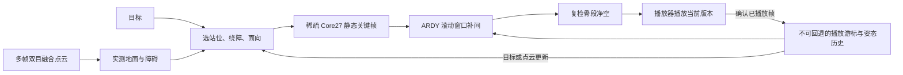

# 点云世界 → 静态关键帧 → 持续 ARDY



新管线从真实双目会话读取完整的**实测融合体素**，不拿渲染抽样、补全点或房屋调试真值当通行依据。根据目标生成站定、面向、挥手或指向的关键姿态。手势会在候选距离与角度中寻找有地面、路径及净空的站位。ARDY 接收全身关键帧条件及路线约束；生成后还会复检最终骨段，失败窗口不交给播放器。

融合前用同一视差层的邻域支撑去掉孤立匹配，不对边缘做均值平滑。融合后，单次实测体素只有在连续两个已定位帧中、其投影附近都实测到明显更远的表面时才会清除。遮挡、缺测和补全点不会提供清除证据；多帧确认的体素不参与这一步。已滤除的像素不会补成规划证据。

## 调用顺序

动作服务：`POST /api/ardy/world/<操作>`。MCP：`ardy_world_playback`（参数用下划线命名）。先开启双目，等待能看见起点及路线附近地面；用 `get_visual_world` 读取 `map.mapId` 和视觉坐标。示例数字不是房屋坐标：

```json
{
  "perceptionClientId": "<双目会话 ID>",
  "mapId": "<融合地图 ID>",
  "start": [0.12, -0.55, -0.36],
  "startHeading": 0,
  "goal": {"action": "point", "target": [0.12, -0.18, -1.61], "standOff": 1.25}
}
```

- `create`：提交上述参数，返回 `sessionId`、`revision`、`futureKeyframes` 和 `path`。只规划、不加载 ARDY。`start` 是**髋部**位置；若取双目的 `pose.bodyPosition`（脚底基准），需加 Core27 站姿髋高约 `0.954 m`。朝向为度，`0=+Z`，`90=+X`。`navigate.target` 填实测地面坐标；`face` 只旋转；`wave/point` 可调整 `standOff`（0.8–2.5 m）。
- `next`：发送 `{sessionId, revision}`，取得最多一个待播窗口。`window.motion` 为 ARDY/Core27 JSON；在此协议中，视觉世界髋位是 `rootDelta + [0, 0.92, 0]`，`rootOrigin` 是模型内部偏置，不是房屋变换。`startFrame`、`endFrame` 为闭区间绝对帧号。重复拉取仍返回当前待播窗口；断线后应跳过其中 `≤ playedThrough` 的帧。
- `played`：播放器实际走过帧后发送 `{sessionId, revision, windowId, throughFrame}`，其中 `throughFrame` 表示该窗口**连续播过**的最后一个绝对帧。播完再 `next`，ARDY 使用最近已确认的姿态继续。生成、收到数据、暂停时都**不能**提前确认。
- `replan`：先停在帧边界并确认游标，再发送 `{sessionId, revision, goal?}`。不传 `goal` 表示用更新的融合点云重查原目标。成功后版本递增，旧窗口全部失效（已播部分已进入历史）；新窗口从 `playedThrough + 1` 开始。若新规划失败，服务器保留旧状态以便检查；播放器应继续暂停，待目标或地图恢复。若规划期间游标推进，本次提交会拒绝，需按新游标重试。地图重置必须新建会话。
- `state`：用 `sessionId` 查询已播/未来关键帧和当前游标。`completed` 指全部帧已确认播放，不是已生成。`close` 用 `{sessionId, revision}` 释放会话。

## 边界

- 当前是可由播放器调用的 HTTP/MCP 管线，现有网页时间轴和自主行为暂未切换至此协议。短窗口需要生成时间，尚未保证实时无等待。地图快照在 `create/replan` 时刷新；播放器负责触发地图更新、停止旧窗口及报告实际播放。
- 仅支持近水平、实测可通行地面。体素净空不等于真实物理安全；稀疏/过期点云、动态障碍、遮挡与未验证的 VRM 重定向都可能使动作被拒绝或需要重规划。不包含抓握、上下楼或支撑动力学。
- 基础回归：`npm run test:core`。真实模型测试（需在配置好 `.env` 的 ARDY Python 下运行）：`/path/to/ardy/.venv/bin/python tests/ardy_world_integration.py`。真实模型测试使用合成点云隔离视觉噪声，不是实景端到端验证。
