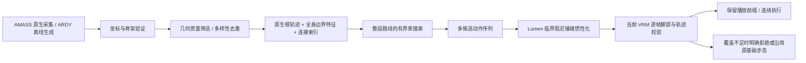

# 社交动作模型：动作表基础

动作表是可重建的动作数据和执行索引，不替代 ARDY。常见移动与手势优先检索已校验素材；缺少覆盖时需要继续采集。开发环境参考表曾包含 425 段：322 移动、12 起步、14 收步、12 转身、10 待机、55 交互动作片段。来自 135 个来源，其中 58 段来自ARDY 生成结果。交互类包含挥手、指向、举手、触摸；完整手势与短窗口分别保存。



源码发布不附带该参考表或 AMASS 派生数据；请按 [资源安装](ASSETS.md) 在本地重建。以下规模与测试记录不代表克隆后已安装。

## 数据与质量

- `public/motion-table/table.json`：版本、来源、动作类别、提示词、帧区间、质量记录、根轨迹和连接图。
- `poses-<hash>.bin`：Float32 原生旋转、根节点位移和接触通道；加载时检查 SHA-256、骨架、数据边界与有限值。
- 每段记录 9 个原生轨迹采样，以及 159 维入口/出口特征：根速度、角速度、双脚接触、22 个有效骨骼局部旋转和角速度。四元数正负号等价。
- 连接代价联合比较全身姿态、关节速度、根运动与接触。离线图是源骨架候选；运行时重新应用当前角色的尺度和速度，并支持从步态内部切入。
- 入库门限：源骨架支撑脚滑动均值 ≤0.14 m/s、P95 ≤0.42 m/s；相邻帧最大关节角 ≤0.45 rad。完整 ARDY 动作也必须通过筛选。
- 当前 VRM 的完整输出另行逐帧检查：滑动均值 ≤0.12 m/s、P95 ≤0.32 m/s；每帧关节变化 ≤0.4 rad。接缝根速度差 ≤0.18 m/s。
- 每个素材用当前 VRM 几何标定统一地面高度基准，避免不同演员的素材串联后脚步上下漂移。支撑校验依赖实际骨骼几何，不依赖人为增加接触标签。

## 路线与平滑

`LocomotionLibrary.compile()` 在单段、柔性时间、含多个点的前进路线中优先使用动作表。`compileTable()` 可直接执行曲线检索；`tableAction()` 根据提示词选择可衔接的完整手势。严格时间表及未覆盖的侧步、倒走等能力没有被伪装为已支持。

路线搜索同时考虑中间轨迹和终点，保留最多 12 个搜索状态、10 条完整候选序列。支持起步、持续步态、最终收步；中间路径点不会自动插入待机。当前单次限制为 30 米、512 个路径点，搜索有时间与深度上限。超限或质量不足会显式报错。自主规划仍由原行为系统提供，本模块不读取房屋真值来选择路线。

根运动只使用素材的刚性旋转、平移与角色步幅标定。保留同一片段的原生曲率，不逐帧拖动根节点贴合目标。自然动作可减速，不以加速补偿时间不足。

接缝直接复用 `vendor/HAST-SEC/motion/v9/damped_output.mjs` 的 `dampedStep`，在旋转切空间衰减新旧姿态及速度残差。滤波只作用于接缝残差，不持续滤掉原生腿部摆动。已播放前缀不回写，不使用锁脚 IK。

## 使用

```sh
# 先安装核心依赖并配置 MOTION_AMASS_DIR
npm run table:build

# ARDY 服务需要已启动；默认对缓存提示词采集两个变体
npm run table:collect
npm run table:build

# 自定义采集任务：JSON 数组 [{"prompt":"缓存提示词","category":"action"}]
npm run table:collect -- --jobs /absolute/path/jobs.json --variants 4 --duration 6

npm run test:table
npm run build
```

前端右侧“动作工具 → 连续动作表”提供来源/质量目录、完整手势执行和前方曲线试走。曲线需要有足够物理空间，家具或墙壁阻挡时会拒绝该路线。手势按钮按所选条目的类别检索完整动作，不把 1.2 秒窗口误当成完整手势。

## 当前边界

这不是“任意规划都能无误拟合”的完成证明。当前库主要覆盖低速平地移动和四类手势；复杂身体接触、楼梯、侧步、倒走、精确动作时长仍需要独立采集和验证。目标触摸的空间接触成功率不属于此次手势播放验收。

滑动指标仍非零；自动门限也不能代替人工观察自然度。长路线的搜索和当前 VRM 几何验证仍在主线程执行，应提前编译；后续可以移入 Worker。AMASS 与各原始数据集的授权条款继续适用，勿把本地原始数据随项目公开发布。

本地报告输出到 `output/`（不发布）。浏览器复现脚本为 `tests/browser-motion-table*.js`。
