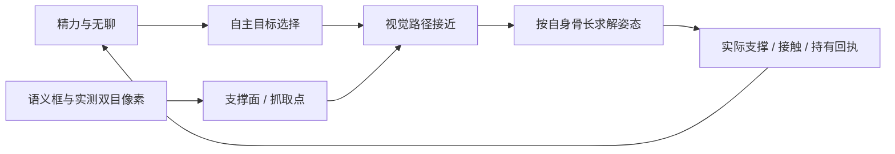

# 交互节点与内在状态

前端角色使用同一个任务队列完成视觉节点交互。规划只读取 YOLO 与同帧双目点云；场景几何仅用于执行支撑/接触验证与道具附着。



## 状态

- 精力、无聊均为 0–100，按真实执行状态和经过时间积分；单次断线间隔最多积入两秒。
- 行走每秒约消耗 0.09 精力；其他动作 0.05；坐稳恢复 0.2，躺稳恢复 0.3。站立待机仅缓慢恢复 0.008。
- 精力 ≤30 进入休息偏好，恢复到 ≥68 才退出；≤16 优先选择足够长的躺卧面。低精力减少自主活动时间预算，不改步态播放速度。
- 无聊在低刺激状态中增长；新视觉对象、完成观察/拿取/社交可降低它。高无聊提高自主活动预算，并尝试已观察到抓取节点的物体。
- 正在执行的目标保持所有权；直接指令可接管。持有物品后自主模式观察六秒，再放回。

## 节点

`server/interaction_nodes.py` 使用实测深度像素提取节点，推断补全像素不能证明支撑。支撑面需水平、具有二维覆盖和足够尺寸；躺卧长度结合角色自身身高判定。抓取点需符合小物体尺寸。语义负责候选类别，几何负责操作条件。

`point/axis` 属于视觉里程计坐标，供规划使用；`controlPoint/controlAxis` 是同帧相机自身标定转换的执行坐标，不在高层物体目录中公开。旧视觉、低精度、无实体支撑、非唯一道具、未触到物体都会失败，不能仅凭动画播放完毕宣告成功。

`InteractionBody` 独立控制坐卧与拿取，原始重定向文件保持不变。坐卧期间不被普通待机覆盖，移动前先起身。坐下前用原生转身动画朝向外侧，腿长与支撑面高度共同决定最后落脚距离。目标在开始转身前必须新鲜；静态支撑节点在短暂转身期间最多保留十秒，坐卧执行前再次检查实体支撑，抓取仍要求两秒内观测。脚部在坐下/下蹲期间使用骨长 IK；躺卧经过坐下、抬脚、躺下阶段。坐稳/躺稳后持久保持姿态。拿取使用手部接触约束并附着独立道具，放回后解除约束。

## 高层接口

先 `get_agent_context` 读取 `interactions.objects[].options` 与 `kernel.needs`。

```json
{"requestId":"rest-1","intent":{"kind":"interact","objectId":"视觉目录中的物体ID","operation":"sit"}}
```

`interact.operation` 新增 `sit`、`lie`、`pickup`。起身、放回不需要重新识别目标：

```json
{"requestId":"stand-1","intent":{"kind":"body","operation":"stand"}}
```

`body.operation` 为 `stand` / `release`。HTTP 沿用 `POST /api/agent/intent`，MCP 沿用 `submit_agent_intent`；`requestId` 重试幂等。完成后查询 `goal.status` 和 `execution.interaction`，其中包含 `supported`、`heldObject`、`lastCommand` 及误差。

## 当前范围

这是运动学支撑与持有适配器，没有力反馈或完整手指接触物理。场景加入可独立拿取的遥控器；其他对象即使被识别为小物体，也需注册可移动实体适配器才能拿起。放回目前返回拿取位置，离开太远时会拒绝放置；尚未支持随意投掷、开关电视或任意物理堆叠。

验收文件放在 `output/needs-interaction/`。骨架/执行器测试与真实视觉端到端测试分开记录，前者通过不代表后者通过。

## 本轮验收边界

- Wolferia 骨架执行器：坐下、起身、分阶段躺卧、拿取、放回、取消恢复和无支撑拒绝均经过程序断言。
- 使用实际房屋沙发、茶几及遥控器的执行器测试通过。该测试明确使用测试摆位与给定节点，图片为 `house-sit.png`、`house-lie.png`、`house-pickup.png`；不属于自动视觉验收。
- 真实网页视觉测试尚未通过：近距离沙发识别不足，双目处理约两秒时，串行语义结果可能超过新鲜度窗口。没有放宽视觉规划门槛，也没有用场景坐标填补检测结果。此时目录不会提供坐卧节点，自主休息无法完成。
- 当前基础可供后续感知优化接入；不应宣称已经能在任意环境稳定自主完成坐沙发、拿遥控器。
