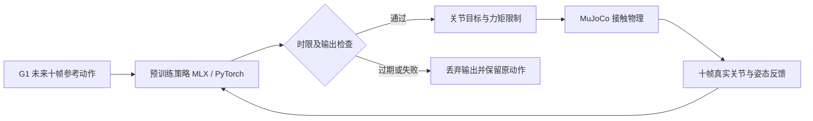
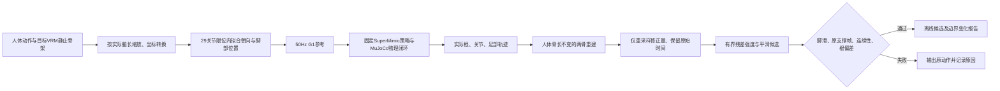

# SuperMimic 可选验证工具

提供固定版本社区预训练策略下载、独立推理及人体 → G1 → 人体的离线候选筛选。源码发布不附带权重、机器人资产或角色标定；网页尚未自动采用候选。

## 权重与来源

- 官方研究代码：`external/SuperMimic`，HybridRobotics/supermimic，Apache-2.0。
- 实际权重：社区独立复现 [pantelismanouselis/g1-supermimic-lafan1](https://huggingface.co/pantelismanouselis/g1-supermimic-lafan1)，并非官方检查点。
- 权重固定版本：`907a358eab1ced90fb09b3df83a67354e7c90e18`，checkpoint 40000。
- 本地目录：`models/supermimic/g1-lafan1-040000/`。
- `policy.safetensors`：36,474,684 字节，SHA256 `a1c409acf38bc11a216a7decb120e4986c587cdd3aa3d383319dfaed990404ef`。
- `config.json`：SHA256 `2dc9e60bb86efc0e35bcac7a063bf6b683ad3d5ef3c6bd853bc814ced46bc2dc`。
- 配套源码：`external/SuperMimic-reproduction`，来自 `Manouselis/supermimic_vibed_fork`，固定 `2e264eaf273232f3bde48ea848e2e6a45949fc73`，网络源码哈希与模型配置一致；仅完整网络一致性测试需要自行检出此版本。

发布者对其拥有的权重权利授予 MIT；第三方数据权利见下载目录中的 `NOTICE.md`。测试参考动作来自 LAFAN1，原始数据适用 CC BY-NC-ND 4.0。机器人资产原始条款保持适用。没有使用官网网页 demo 的专有权重，也没有下载完整训练集。

## 当前运行范围

这是一套 **Unitree G1、29 个关节、50 Hz 的物理动作跟踪策略**。输入是十帧本体反馈和未来十帧参考动作，输出需经过官方尺度转换和带力矩限制的关节驱动，再由物理环境产生实际姿态。下载的权重包含动作编码器、策略解码器和归一化参数；不含用于训练的世界模型，因此当前执行的是固定策略推理，没有在线训练权重。



服务独立监听 `127.0.0.1:8300`，默认使用 CPU 单线程，不会在前端动画帧中同步执行推理。推理固定在一个独立工作线程，并在该线程中预热。每次只允许一个推理请求；繁忙返回 429，不排积压。最多 16 个会话，120 秒闲置过期，耗时记录最多 512 条。连续请求必须给出递增序号与上一帧实际采用的策略输出；重复、缺帧、反馈不一致返回 409。默认 20 ms 时限，过期返回 504，并且不推进会话历史。故障后调用方应保留原动作，并按实际状态重置或重新提交。

`vrmEnabled=false`、`appliedToVrm=false` 是当前真实状态。服务拒绝 VRM/SMPL 骨架输入。**离线工具通过语义骨架标定和物理残差重建产生人体候选，不能直接把机器人的29个标量关节当作人体27个三维旋转。原重定向、主步态和动作表没有修改。**

## 验证范围

开发环境曾完成独立推理、G1 参考跟踪与人体候选筛选。源码发布不包含本地报告、VRM 标定、权重或测试动作，因此不将历史延时数字作为发布性能承诺。请在自身硬件、合法资产和实际负载下重新运行下列脚本。

MLX 曾出现空闲后首请求超过 20 ms 的情况，因此服务默认使用 CPU 单线程；超时结果会被拒绝。离线吞吐不能代替真实服务延时和人体自然度验收。

## 命令

```sh
# 当前项目已安装下列可选运行依赖；新环境使用此文件。
uv pip install --python .venv-perception/bin/python -r server/requirements-supermimic.txt
npm run supermimic:download
npm run supermimic:assets
npm run supermimic:benchmark
npm run supermimic:tracking -- --seconds 600
npm run test:supermimic
npm run supermimic:service
# 服务启动后：
.venv-perception/bin/python scripts/validate_supermimic_http.py --seconds 20
```

服务支持 `--backend torch --threads 1`（默认）或 `--backend mlx`。后端切换必须重启独立服务，不影响原 5173/8100/8200 服务。

## 接口

`GET /health` 返回实际后端、会话数量、P95、超时丢弃次数和 VRM 接入状态。

`POST /infer`，`Content-Type: application/json`。仅供本机后端适配器使用，带浏览器 Origin 的请求拒绝。请求上限 64 KiB：

```json
{
  "profile": "unitree-g1-29dof",
  "sessionId": "character-1",
  "sequence": 0,
  "reset": true,
  "deadlineMs": 20,
  "observation": ["99个float；按模型config.json的顺序"],
  "goal": ["730个float；未来10帧，每帧73维"]
}
```

上例中的字符串仅作维度说明，不能作为有效推理请求。第一帧 `previous_action` 必须为零。后续 `reset=false`，序号加一，`observation[64:93]` 必须与上一帧返回并实际采用的 `action` 一致。返回 29 维 `action`、按命名关节排列的 `jointTargets` 和真实推理耗时。目标角度仍需物理控制器执行，不能视为实际姿态。

参考特征与坐标转换在 `server/supermimic_reference.py`：Z-up，根四元数输入 xyzw；6D 旋转为矩阵前两列按行展开。未来超出片段末尾时保持末帧姿态、速度清零。

## 人体与 G1 双向适配



新增代码：`supermimic_skeleton.py`、`supermimic_avatar.py`、`supermimic_bridge.py`、`supermimic_human_ik.py`、`supermimic_refinement.py`、`supermimic_optimizer.py`。修正工具不访问导航场景真值。人体 Y-up/+Z前 与 G1 Z-up/+X前通过右手坐标旋转共轭转换；缩放由实际腿段长度决定。末帧补保持使50Hz参考覆盖源片段，反向只插值修正量，零物理修正可精确还原原始采样。

目标 VRM 标定读取归一化骨骼静止位置；重复语义关节沿用原重定向的最深节点选择，未映射的头、手指和辅助关节保留原局部动作。根位移使用与原播放一致的标定比例。当前测试的 idle 根比例0.75为原测试回退值，其他三例由原始动作脚步标定得到；不能据此声称所有角色和动作均已标定。

每段实际物理轨迹生成残差重建和完整脚轨迹重建两种候选，再搜索4个修正强度与4个时间平滑宽度，共32个候选；不改变动作时长、不锁普通行走脚、不单独调候选根比例。除了候选自身支撑帧，还检查**原动作相同支撑帧**，避免通过改变支撑判定降低分数。仅保留通过筛选的候选，其余 `output` 完整返回原输入。离线候选会删除失效的旧接触标签与质量/检索元数据，导入动作表前必须重建。

四段开发样本中仅一段步行候选通过所有筛选，其余保留原动作；不能据此证明全动作库改善。公开源码不附带角色专属标定和测试报告，必须自行验证。

运行命令：

```sh
# 原骨架研究；默认输出4段源/候选/实际采用动作和报告
npm run supermimic:optimize
# 使用自行生成的角色骨架标定及片段根比例
npm run supermimic:optimize -- \
  --avatar /absolute/avatar-profile.json \
  --output output/supermimic/avatar-bridge
# 任意带语义骨骼/restJoints的Y-up动作，可显式指定角色根比例
npm run supermimic:optimize -- --input /absolute/motion.json \
  --avatar /absolute/avatar-profile.json --root-scale 0.78
npm run test:supermimic
```

`tests/browser-supermimic-bridge.js` 使用原 `VrmRetargeter` 加载实际VRM对照，返回可导出的 profile 与 comparisons；`bridgeDirectory`、`bridgeAvatar` 页面参数可选择测试输出目录和模型。新增人体桥接测试与原推理测试合计32项，涵盖骨长缩放、右手坐标、零残差精确往返、重复语义折叠、非法骨架、真实预训练策略及退步回退。

当前是**固定预训练策略下的动作修正与候选筛选，没有梯度微调权重**，整段骨架拟合/物理跟踪/候选筛选仍在离线CLI执行。`accepted`只表示片段级筛选通过，`avatarValidated=false`表示尚未完成主播放环境及连续切换验收。没有新增实时人体HTTP优化入口，也没有开启网页接管；动作衔接索引和接触标签必须重建，并验证长程路线、切换、坐下/拿取接触后才能投入主动作系统。`footHeightMin`是相对根的FK坐标，不能直接当作穿地深度。
